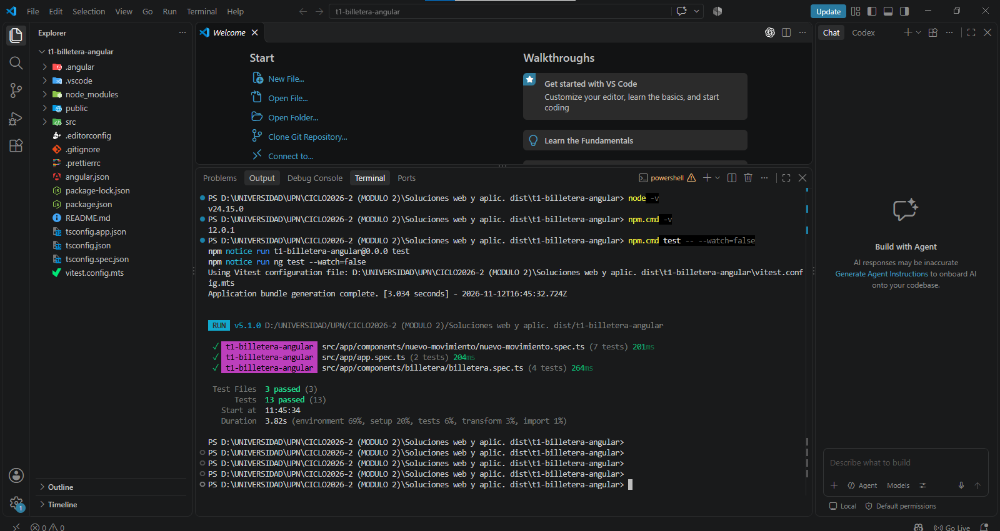
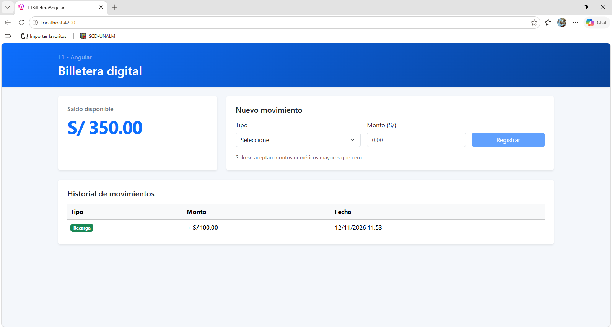
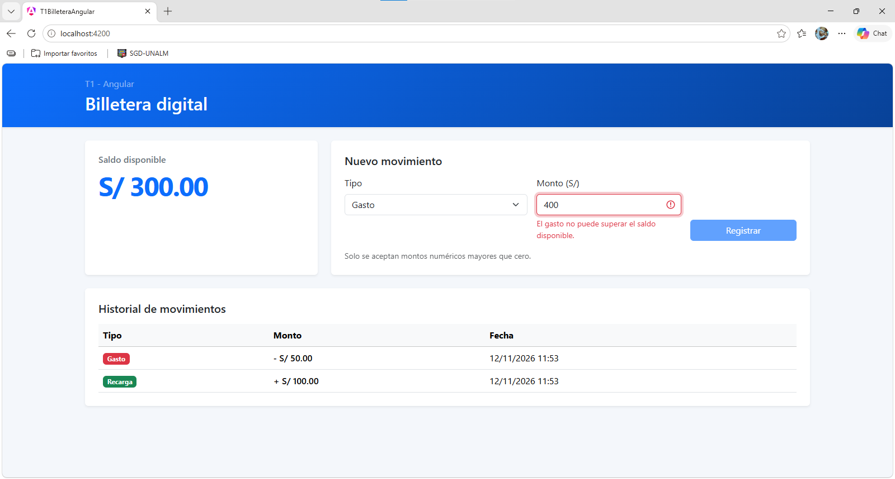
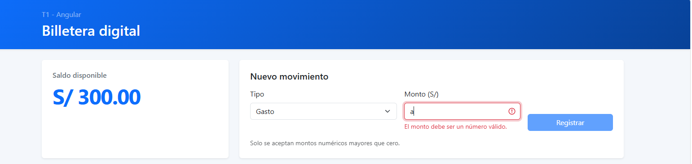
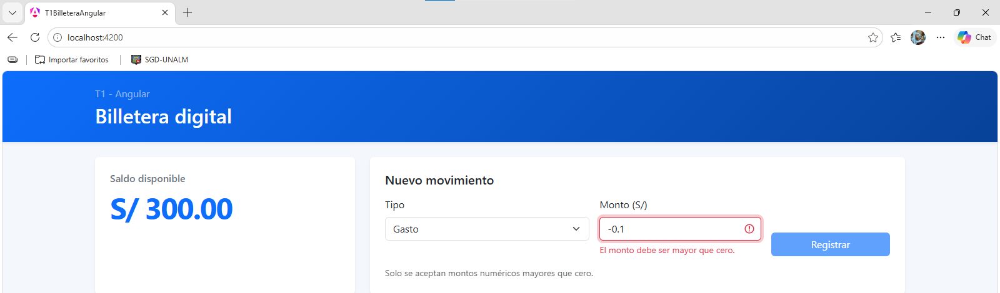

# Billetera digital - Angular

Aplicación web de billetera digital desarrollada con Angular, componentes standalone, signals y Bootstrap. El estado permanece en memoria mientras la aplicación está abierta.

## Tecnologías

- Angular 22.2.5
- Angular CLI 22.2.6
- Node.js 24.15
- npm 12.0.1
- TypeScript 6.0.3
- Bootstrap 5.3

## Componentes

- `BilleteraComponent`: componente padre y único propietario del saldo y el historial.
- `NuevoMovimientoComponent`: componente hijo que recibe el saldo mediante `input()` y emite únicamente movimientos válidos mediante `output()`.
- `AppComponent`: contenedor mínimo de la aplicación.

La vista utiliza interpolación, `@if`, `@for`, property binding y event binding. No se utilizan servicios, rutas, formularios reactivos ni backend.

## Funcionalidades

- Saldo inicial de S/ 250.00.
- Registro de recargas y gastos.
- Historial ordenado del movimiento más reciente al más antiguo.
- Comunicación entre componentes padre e hijo.
- Botón deshabilitado mientras el formulario sea inválido.
- Mensajes de validación visibles junto al campo correspondiente.

## Validaciones

La aplicación rechaza:

- campos vacíos;
- texto o valores no numéricos como `A`;
- cero y números negativos como `-1`;
- montos con más de dos decimales;
- gastos mayores que el saldo disponible.

Un movimiento inválido no se emite al componente padre y, por lo tanto, no modifica el saldo ni el historial.

## Ejecución

1. Instalar Node.js 24 y npm 12.
2. Instalar las dependencias:

   ```bash
   npm install
   ```

3. Iniciar la aplicación:

   ```bash
   npm start
   ```

4. Abrir `http://localhost:4200/`.

## Pruebas automatizadas

Ejecutar la suite una sola vez:

```bash
npm test -- --watch=false
```

La suite verifica el saldo inicial, el orden del historial, la secuencia de
recarga y gasto, el sobregiro y el rechazo de valores vacíos, no numéricos,
cero, negativos o con más de dos decimales.

### Evidencia de las pruebas

La ejecución validada en Node.js 24.15.0 y npm 12.0.1 aprobó los tres archivos
de prueba y sus trece casos.



## Casos mínimos de comprobación

| Caso | Resultado esperado |
| --- | --- |
| Abrir la aplicación | Saldo S/ 250.00 e historial vacío |
| Recargar S/ 100.00 | Saldo S/ 350.00 y recarga al inicio del historial |
| Gastar S/ 50.00 | Saldo S/ 300.00 y gasto al inicio del historial |
| Gastar S/ 400.00 | Operación rechazada; saldo permanece en S/ 300.00 |
| Ingresar vacío, `A`, `0` o `-1` | Botón deshabilitado y estado sin cambios |

## Evidencias de ejecución

### Estado inicial

La aplicación inicia con S/ 250.00, historial vacío y el botón deshabilitado.


### Recarga de S/ 100.00

La recarga incrementa el saldo a S/ 350.00 y se registra en el historial.



### Gasto de S/ 50.00 y rechazo de sobregiro

El gasto válido reduce el saldo a S/ 300.00 y aparece antes de la recarga. Al
ingresar un gasto de S/ 400.00, el formulario muestra el error y deshabilita el
botón sin modificar el estado.



### Rechazo de texto

El formulario rechaza entradas no numéricas y mantiene el botón deshabilitado.



### Rechazo de un monto negativo

Los montos negativos son rechazados sin alterar el saldo ni el historial.



## Estructura principal

```text
src/app/
|-- app.ts
|-- app.spec.ts
|-- components/
|   |-- billetera/
|   |   |-- billetera.ts
|   |   |-- billetera.spec.ts
|   |   |-- billetera.html
|   |   `-- billetera.css
|   `-- nuevo-movimiento/
|       |-- nuevo-movimiento.ts
|       |-- nuevo-movimiento.spec.ts
|       |-- nuevo-movimiento.html
|       `-- nuevo-movimiento.css
`-- models/movimiento.ts
```

## Restricciones del proyecto

- No utiliza base de datos.
- No incluye autenticación.
- No consume API externas.
- No utiliza servicios ni enrutamiento de Angular.
- No utiliza formularios reactivos.
